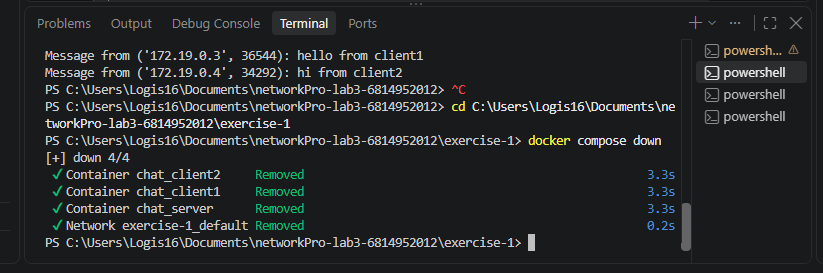
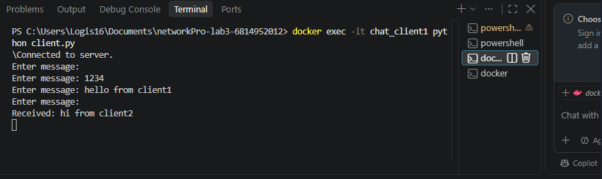
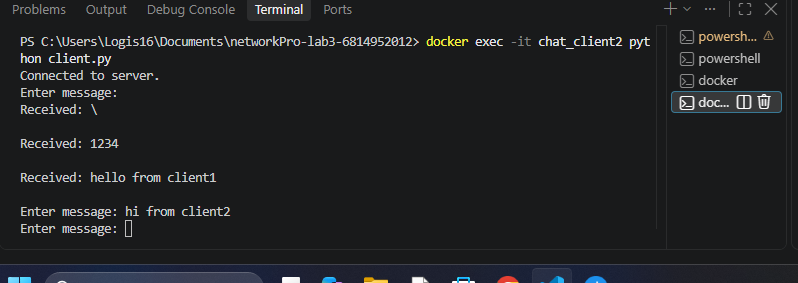
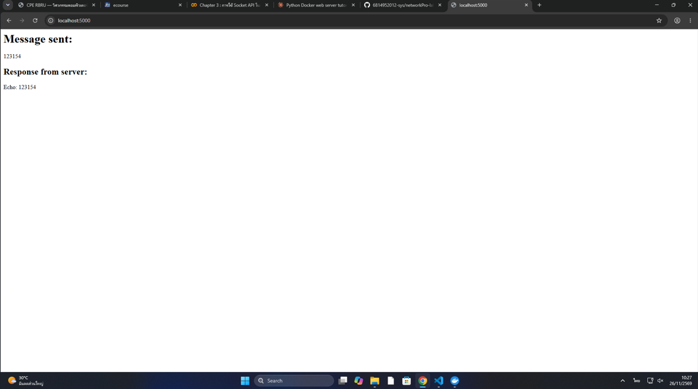

# รายงานแบบฝึกหัด Socket API & Docker

## ข้อมูลผู้จัดทำ
- ชื่อ-นามสกุล: ภัทรพล นาคสกุล
- รหัสนักศึกษา: 6814952012

---

## แบบฝึกหัดที่ 1: ระบบ Chat ด้วย Docker (2 Clients และ 1 Server)

ระบบแชทใช้ Socket API แบบ TCP มี Server กลางส่งต่อข้อความระหว่าง Client 2 ตัว รันด้วย Docker Compose

### วิธีรัน
```bash
cd exercise-1
docker compose up -d --build
docker exec -it chat_client1 python client.py
docker exec -it chat_client2 python client.py
```

### ผลการทดสอบ
   


---

## แบบฝึกหัดที่ 2: เว็บ Flask และ Socket Server

เว็บ Flask รับข้อความจากฟอร์ม (POST) ส่งต่อไปยัง Socket Server แล้วแสดงคำตอบ (Echo) บนหน้าเว็บ

### วิธีรัน
```bash
cd exercise-2
docker compose up --build
```
เปิด http://localhost:5000

### ผลการทดสอบ

---

## หยุดการทำงาน
```bash
docker compose down
```